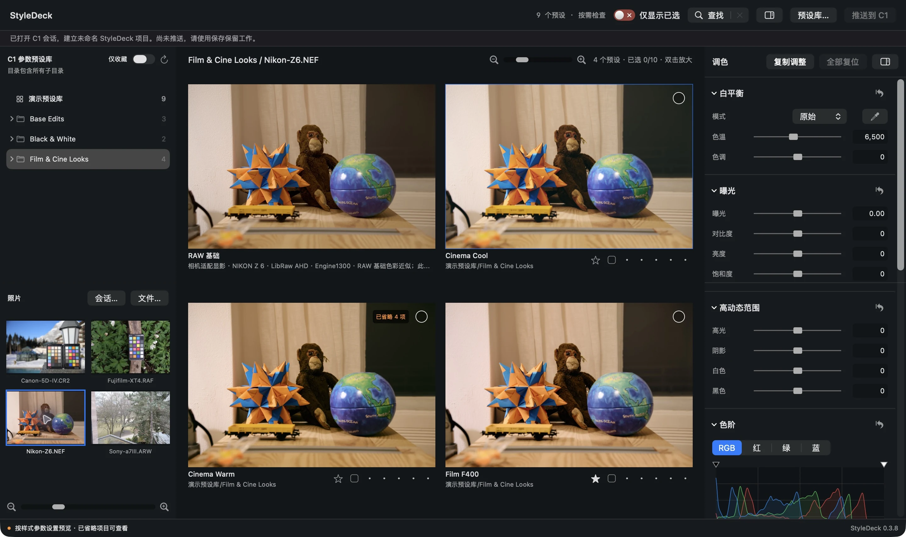

# StyleDeck

[English](README.en.md) · [中文使用指南](docs/index.html?lang=zh) · [English guide](docs/en.html?lang=en)

Capture One 工作流的独立辅助工具：并排比较已有预设、整理候选、检查与微调效果，再将选中的候选推回 Capture One 继续处理。

## 版本与下载

当前准备发布 **0.4.8 / build 37，Apple Silicon（arm64）**。公开下载入口尚未启用。

安装包经过 Developer ID 签名及 Apple 公证。公证表示通过 Apple 的分发安全检查，不代表 Capture One 官方认证或资源授权审核。

## 系统要求与安装

- Apple Silicon Mac；当前安装包不支持 Intel Mac。
- 最低系统声明为 macOS 14；macOS 14/15 实机及干净 Mac 离线首启仍待验证。
- 推送功能需要用户自行安装并取得有效授权的 Capture One；预设也需用户自行合法取得。
- 下载 DMG 后打开，将 StyleDeck 拖入“应用程序”，再从“应用程序”启动。
- 首次推送时，允许 StyleDeck 自动化控制 Capture One。若曾拒绝，可到“系统设置 → 隐私与安全性 → 自动化”检查。

## 主要功能

- 打开 Capture One 会话或导入照片，比较多个 .costyle 预设。
- 勾选候选、收藏预设、使用星级与色标整理选择。
- 放大检查、局部查看、独立调整与项目保存恢复。
- 将候选推送到指定 Capture One 会话，或导出 JPEG / PNG。
- 简体中文、繁体中文和英文界面。

## 使用边界

支持情况取决于照片格式、相机、预设活动参数及所需资源；界面会显示未支持或省略的项目。预览与 Capture One 的成片不保证逐像素一致，重要项目应先使用副本测试并核对结果。

“已推送”表示操作执行及保存、目标身份、预设与标记等必要确认完成，不表示所有调色数值逐项相等或成片像素一致。

## 许可

免费提供，按 [PolyForm Strict License 1.0.0](LICENSE.txt) 使用。许可允许非商业用途，包含原文列出的个人用途与非商业组织类别；不提供商业使用、修改或再分发授权。它不是开源许可。本说明以许可英文原文为准。

[版权与适用范围](NOTICE.md) · [第三方声明](THIRD_PARTY_NOTICES.md) · [照片署名](docs/content/PHOTO-CREDITS.md)

## 反馈

公开反馈请附软件版本、macOS 版本、机型和复现步骤。不要公开上传私人照片、完整会话、预设库或包含个人路径的日志。

本项目是独立辅助工具，与 Capture One 无隶属、赞助或官方背书关系。
